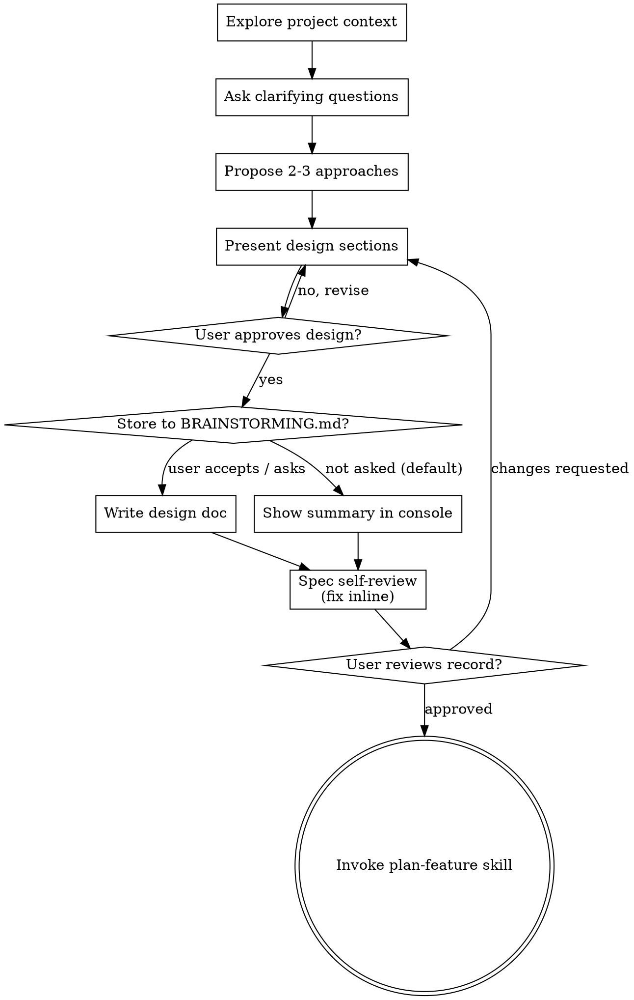

# Brainstorming Ideas Into Designs

Help turn ideas into fully formed designs and specs through natural collaborative dialogue.

Start by understanding the current project context, then ask questions one at a time to refine the idea. Once you understand what you're building, present the design and get user approval.

<HARD-GATE>
Do NOT invoke any implementation skill, write any code, scaffold any project, or take any implementation action until you have presented a design and the user has approved it. This applies to EVERY project regardless of perceived simplicity.
</HARD-GATE>

## Anti-Pattern: "This Is Too Simple To Need A Design"

Every project goes through this process. A todo list, a single-function utility, a config change — all of them. "Simple" projects are where unexamined assumptions cause the most wasted work. The design can be short (a few sentences for truly simple projects), but you MUST present it and get approval.

## Checklist

You MUST create a task for each of these items and complete them in order:

1. **Explore project context** — check files, docs, recent commits
2. **Ask clarifying questions** — through `grilling`, which owns the interview technique. Show rather than tell where the question is genuinely visual — a console table or ASCII diagram, never a browser (see Showing instead of telling)
3. **Understand purpose, constraints and success criteria** before proposing anything
4. **Propose 2-3 approaches** — with trade-offs and your recommendation
5. **Present design** — in sections scaled to their complexity, get user approval after each section
6. **Ask whether to store the record** — write to `BRAINSTORMING.md` only if the user accepts or explicitly asks to store it; otherwise the record stays in chat (see Where the design goes)
7. **Record the design** — append the dated section to `BRAINSTORMING.md` if storing, or present the full summary in the console if not — detail is not constrained in the console case (see Where the design goes)
8. **Self-review, then user reviews the record** — quick inline check for placeholders, contradictions, ambiguity, scope (see below), then ask the user to review before proceeding
9. **Transition to implementation** — once the user agrees, invoke `plan-feature` to turn the design into a `PLAN.md` item

## Process Flow

**The terminal state is invoking `plan-feature`.** Do NOT invoke frontend-design, mcp-builder, or any other implementation skill. The ONLY skill you invoke after brainstorming is `plan-feature`.

## The Process

**Understanding the idea:**

- Check out the current project state first (files, docs, recent commits)
- Before asking detailed questions, assess scope: if the request describes multiple independent subsystems (e.g., "build a platform with chat, file storage, billing, and analytics"), flag this immediately. Don't spend questions refining details of a project that needs to be decomposed first.
- If the project is too large for a single spec, help the user decompose into sub-projects: what are the independent pieces, how do they relate, what order should they be built? Then brainstorm the first sub-project through the normal design flow. Each sub-project gets its own spec → plan → implementation cycle.
- For appropriately-scoped projects, **run the interview through `grilling`** — it owns the technique: one
  question per message, each carrying a recommended answer, facts resolved by reading rather than asked
- Prefer multiple choice questions when possible, but open-ended is fine too
- Focus on understanding: purpose, constraints, success criteria

**Exploring approaches:**

- Propose 2-3 different approaches with trade-offs
- Present options conversationally with your recommendation and reasoning
- Lead with your recommended option and explain why

**Presenting the design:**

- Once you believe you understand what you're building, present the design
- Scale each section to its complexity: a few sentences if straightforward, up to 200-300 words if nuanced
- Ask after each section whether it looks right so far
- Cover: architecture, components, data flow, error handling, testing
- Be ready to go back and clarify if something doesn't make sense

**Design for isolation and clarity:**

- Break the system into smaller units that each have one clear purpose, communicate through well-defined interfaces, and can be understood and tested independently
- For each unit, you should be able to answer: what does it do, how do you use it, and what does it depend on?
- Can someone understand what a unit does without reading its internals? Can you change the internals without breaking consumers? If not, the boundaries need work.
- Smaller, well-bounded units are also easier for you to work with - you reason better about code you can hold in context at once, and your edits are more reliable when files are focused. When a file grows large, that's often a signal that it's doing too much.

**Working in existing codebases:**

- Explore the current structure before proposing changes. Follow existing patterns.
- Where existing code has problems that affect the work (e.g., a file that's grown too large, unclear boundaries, tangled responsibilities), include targeted improvements as part of the design - the way a good developer improves code they're working in.
- Don't propose unrelated refactoring. Stay focused on what serves the current goal.

## After the Design

**Ask before writing anywhere — console by default, the file only on request:**

- Once the user approves the design, ask whether to store it: *"Store this to `BRAINSTORMING.md`, or just
  keep it here in chat?"*
- **Default is console.** Only write to `BRAINSTORMING.md` if the user accepts or explicitly asks to store
  the record. A design that stays in chat is not incomplete — it simply has no file.
- **The console summary can run long.** It stands in for the file record, so give it the same detail a
  written spec would carry — architecture, components, data flow, error handling, testing. The usual
  chat-brevity guidance does not apply to this summary.

**Where the design goes, if the user asks to store it — `BRAINSTORMING.md`, and only there:**

- Write the validated design as a new section of **`BRAINSTORMING.md` at the repo root**, headed
  `## YYYY-MM-DD — <topic>`. One file, appended to; never a file per design.
- Open every section with a status line stating that it is **ideas, not instructions** — nothing in
  `BRAINSTORMING.md` is approved, and nothing in it is a `PLAN.md` item.
- Do **not** run `git add` / `git commit` / `git push`. Root `CLAUDE.md` reserves committing for the
  operator; output the commit message text in chat instead if one is wanted.
- Use elements-of-style:writing-clearly-and-concisely skill if available

**The section is temporary — delete it when it becomes a plan item.**

`BRAINSTORMING.md` is a staging area, not an archive. The moment a design (or a part of one) is written
into `PLAN.md ## New Instructions` as an `NI-nn` item, **remove that content from `BRAINSTORMING.md` in
the same task**. The item is then the only home for it.

- If the whole section became one item, delete the whole section.
- If only part of it did, delete that part and leave the rest, noting which id absorbed it
  (`— promoted to NI-nn, <date>`) so the remaining ideas still read in context.
- If a section is emptied this way, delete its heading too. An empty dated heading is not a record.
- A design that is *rejected* is deleted just the same, with one line saying so. `BRAINSTORMING.md` holds
  only live, unpromoted ideas.

This is the same rule `PLAN.md` applies to a completed item — one fact, one home. Two copies of a design
drift, and the stale one is always the one someone reads.

**Spec Self-Review:**
After producing the record — the `BRAINSTORMING.md` section or the console summary — look at it with fresh eyes:

1. **Placeholder scan:** Any "TBD", "TODO", incomplete sections, or vague requirements? Fix them.
2. **Internal consistency:** Do any sections contradict each other? Does the architecture match the feature descriptions?
3. **Scope check:** Is this focused enough for a single implementation plan, or does it need decomposition?
4. **Ambiguity check:** Could any requirement be interpreted two different ways? If so, pick one and make it explicit.

Fix any issues inline. No need to re-review — just fix and move on.

**User Review Gate:**
After the spec review loop passes, ask the user to review the record before proceeding:

- If stored: *"Design written to `BRAINSTORMING.md` § `<heading>`. Please review it and let me know if you
  want to make any changes before we turn it into a PLAN.md item."*
- If not stored: *"That's the full design above — let me know if you want changes, or say the word and I'll
  turn it into a PLAN.md item."*

Wait for the user's response. If they request changes, make them and re-run the spec review loop. Only proceed once the user approves.

**Implementation:**

- Invoke `plan-feature` to turn the approved design into a `PLAN.md ## New Instructions` item
- Do NOT invoke any other skill. `plan-feature` is the next step.
- If the design was stored, remove the promoted content from `BRAINSTORMING.md` once the item exists — see
  *The section is temporary* above. If it was never stored, there is nothing to remove.

## Key Principles

- **One question at a time** - Don't overwhelm with multiple questions
- **Multiple choice preferred** - Easier to answer than open-ended when possible
- **YAGNI ruthlessly** - Remove unnecessary features from all designs
- **Explore alternatives** - Always propose 2-3 approaches before settling
- **Incremental validation** - Present design, get approval before moving on
- **Be flexible** - Go back and clarify when something doesn't make sense

## Showing instead of telling — in the console

Some questions are answered faster by looking than by reading. Answer them **in the console**, with a table
or an ASCII diagram. No browser, no server, no extra tab.

Pick the form from what the question actually is:

| The question is about | Use | Why |
|---|---|---|
| Comparing options on shared criteria | **A table** — one row per option, one column per criterion, your recommendation marked | The comparison is the answer; prose hides it |
| A flow, a pipeline, a lifecycle | **An ASCII diagram** — boxes, `──▶`, branch labels | Order and branching are spatial |
| Layout or structure | **An ASCII wireframe** — `┌─┐ │ └─┘`, labelled regions | Enough to decide placement, which is what is being asked |
| A data shape | **A fenced JSON or table sketch** | Field names and nesting, nothing more |
| A requirement, a constraint, a scope call, a tradeoff | **Prose or a short list** | Not visual. A diagram of a text question adds nothing |

Rules:

- **Width ≤ 100 characters.** It is being read in a terminal.
- **Label every branch and every edge.** An unlabelled arrow is decoration.
- **One diagram per question.** Two diagrams means two questions.
- **A legend only if a glyph is not obvious.** `✅ / ❌ / ⚠` need none.
- **Never render a text question as a diagram.** *"What does 'author' mean here — a label or an audit
  record?"* is prose. *"Which of these three wizard layouts?"* is a wireframe.
- **The diagram is the question, not an illustration of it.** If the operator could answer without looking at
  it, it should not have been drawn.
